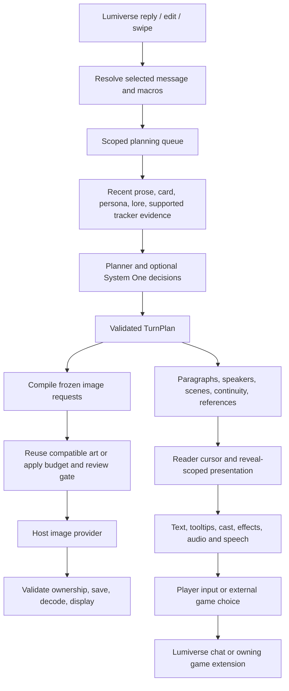

# Lumiglyphics: architecture audit and feature directions

Research completed 13 October 2026. Audited `Testing`, version `0.2.0-beta.20`, commit `c888809ebfe417581786da7af419ab4b6711608c`. The remote Testing head was checked and matches. This is a research and recommendation document, not an implementation specification or a claim of flawless operation.

## Recommendation

Make Lumiglyphics an excellent interactive presentation layer: it should turn existing roleplay into a coherent scene that is comfortable to read, hear, inspect and act within. Its strongest opportunity is coordinating the systems it already has. Another general memory engine, stats engine or scripting platform would duplicate the user's existing stack and introduce competing sources of truth.

Three possible directions:

| Direction | Value | Tradeoff |
|---|---|---|
| Refined illustrated reader | Fastest gains in usability, reliability and image control | Less new gameplay |
| Interactive scene presentation — recommended | Cast, places, contextual actions, documents, sound and consequences feel connected | Requires dependable entity identity and reveal timing |
| Complete autonomous RPG platform | Broadest game mechanics | Considerably larger scope; duplicates Warp, LumiBooks and LumiScript |

Preserve mobile-first controls, optional dynamic templates, optional prompt review, the shared image budget, independently toggleable tooltip categories, existing themes and standalone operation. Scenario/world/narrator cards are first-class inputs. New ideas below are proposals; previously deferred storyboard editing, bookmark timelines and presentation packs remain deferred.

## What the extension actually does

### Runtime flow

**Host boundary.** `src/backend.ts` registers the runtime controller. `src/frontend.ts` returns frontend cleanup. The frontend mounts its own stage, temporarily overrides native chat components and retains an exit path. It submits normal user messages through the host; it is not the main story-writing model. `chat_mutation` and `app_manipulation` therefore have concrete purposes.

**Intake and ownership.** `message-text.ts` resolves macro-bearing messages without committing macro mutations, separates resolved narrative from selection identity, and avoids planning unselected greeting branches. `controller.ts` combines user/chat scope, message ID, swipe, source fingerprint and revision with intake epochs and abort controllers. This is essential when an image or planner result finishes after a swipe, edit, cancellation or chat switch. Automatic work is gated by whether the reader is open.

**Planning.** `planner.ts` asks a sidecar model for scenes, speakers, visual cues, continuity, effects, audio and optional choices/references. It validates model output, repairs or falls back when necessary, and distinguishes speakers from drawable subjects. Scenario-subject recovery prevents a world-card title from automatically becoming a person. Optional `system-one.ts` adds separate typed classification requests; describing every configuration as exactly one model call would be inaccurate.

**Context.** `context.ts` bounds card, persona and activated-lore material. `simtracker.ts` separately scans recognized tracker payloads in up to 30 messages through the target reply. Context-source RPC checks for LumiBooks/LumiScript currently produce availability reports, not imported image or tooltip facts. A detected integration is not necessarily an active source of presentation facts.

**Image compilation.** Templates supply structure; shared prefix, suffix and negatives supply reusable wording. `{{suffix}}` comes from the saved `promptSuffix` setting, not from a hidden story tracker. Scene, subject, action, composition and lighting placeholders are populated by the prepared visual brief. A template that omits a placeholder does not include that block. Fixed or dynamically selected templates, output dimensions, provider settings and references are frozen into the prepared request.

The combined positive/negative limit is 3,000 characters. The planner is instructed to aim for 2,500–2,800 when grounded detail warrants it. Exact duplicate lines/exclusions can be removed; unique overlong material is held for correction instead of silently clipped. Length is guidance rather than a quality metric. The existing template subject schema is one person or no people; showing two separate portraits is not the same as reliable multi-person image generation.

**Scheduling and review.** Image jobs pass through budget, compatibility, reference dependencies and approval gates. Manual replacements preserve previous usable art on failure. A completed provider response is distinct from a decoded browser-ready image. Closing or superseding work rejects late results, but cannot guarantee that a provider stops already dispatched work or billing.

**Three kinds of visual persistence.** The temporary scene cache, persistent place/portrait libraries and reference-anchor storage serve different purposes. Persistent libraries use conservative request/environment/appearance matching. Supplied gallery artwork is a display override for a saved appearance; it is not automatically an image-model reference. Exact matching protects identity but can miss reuse when equivalent scenes are described differently.

**Reader.** The frontend has deterministic paragraph progression, acknowledgement/input gates, history, auto/skip, resizing, opacity and theme controls. Tooltips are optional and category-filtered. References are linked in rendered text without rewriting canonical chat. Cast view arranges available compatible assets; it does not independently allocate new background and portrait requests yet.

**Audio.** BGM/SFX use an audio catalog and paragraph cues. Speech has its own transport, voice resolution, cancellation epochs and bounded blob cache. Current attribution is one voice per whole paragraph, which limits mixed narration/dialogue performance. Hidden/inactive views suppress speech work. These existing systems make coordinated staging feasible without inventing an entirely new audio subsystem.

**Extension bridges.** Window-event bridges carry game choices, panels and external image requests. Warp retains action execution. Panel capture is a display snapshot, not a structured truth source. LumiScript RPC and LumiBooks Codex snapshots offer more useful future structured boundaries than scraping their rendered panels.

## Audit findings

These are targeted findings, not an exhaustive security certification. Two behavior probes, a capacity probe, focused unit tests and browser fixtures were used to separate observed behavior from architectural concerns.

### A1 — Medium: saved place-art lookup can outlive a reset

`src/backend/runtime/location-art.ts:30` loads a library, awaits `images.get`, then returns the old variant without checking its management epoch. `manageLocationArt` increments an epoch, but only saves currently use it. The equivalent cast lookup has stronger invalidation.

**Reproduced:** start lookup; pause image existence verification; reset the library; complete verification. The library has zero locations, but lookup returns the old image. Call sites in `images.ts:615` and `images.ts:770` consume this result. The controller clears scene-cache scope after management, but this helper does not validate the location epoch.

**Fix:** capture/recheck location epoch around asynchronous reads and immediately before admitting the result. Test reset, forget and preferred-variant changes. Resetting library metadata should not delete already displayed art, but new reuse decisions should honor the reset.

### A2 — Medium: SimTracker compatibility is narrower than its supported formats

`src/backend/runtime/simtracker.ts:43` scans message text and parses blocks with `JSON.parse`. The inspected SimTracker supports JSON and YAML, configurable markers, and backend history that survives removal of tracker blocks from stored messages.

**Reproduced:** a character appearance in JSON is detected; equivalent YAML is reported malformed. When tags are removed, the text-scanning path can also have nothing to read. SimTracker's `get_latest_tracker` frontend message is not a public cross-extension historical API that Lumiglyphics can safely assume it may call.

**Fix:** report the distinction between absent, unsupported format and stripped payload. Add bounded format support or agree on a public, user/chat/message-scoped snapshot contract. Never replace historical state with the latest global macro; SimTracker currently renders `last_sim_stats` as prompt-efficient Markdown.

### A3 — Medium: long-turn presentation data has a sharp capacity cliff

`presentation-timeline.ts` repeats full entities/facts/state in each paragraph snapshot. `entity-projection.ts:85` and `readerPresentationFor` discard presentation above 512,000 serialized characters. There are also 256-paragraph and 64-delta gates.

**Reproduced:** 60 paragraphs with 12 entities and one 400-character description each produce 648,977 serialized characters; the reader projection rejects it. The probe exercises the snapshot/reader boundary, not a paid model response. The narrative still exists, but presentation-dependent features can become unavailable together.

**Fix:** store a shared entity/fact table plus reveal-indexed deltas and derive the cursor view. Retain limits, but expose a reason and degrade individual enrichments rather than silently losing the entire projection. Do not simply increase every cap.

### A4 — Medium: visual interpretation and observed tooltip facts need distinct provenance

Literal `storyReferences` are strictly checked against their paragraph by `shared/story-references.ts`. However, `entity-projection.ts:34` also labels scene descriptions and resolved visual identities as `observed` facts without that literal-evidence check. These fields can originate from the visual planning/context route.

**Confirmed code distinction; not a reproduced live secret leak.** A useful visual description is not automatically something the viewpoint learned at that paragraph. This matters before importing Codex or tracker data containing hidden information.

**Fix:** separate visual direction, established reference and viewpoint-revealed fact. Display inferred decorative details as interpretation, or exclude them from factual dossiers. Require source and reveal evidence before promoting external facts into the reader.

### A5 — Low now, medium for future integrations: game-choice IDs lose their provider namespace

`frontend/host/controller.ts:498` strips provider when forwarding choices to the stage; line 547 finds a selected choice by ID alone. The stage also selects by bare ID. Two providers both publishing `talk` can collide.

**Source-confirmed ambiguity; no claim that current Warp-only use is broken.** Carry `(provider,id)` through rendering and selection before adding another action provider. Add source revision/expiry to prevent old choices being mistaken for current ones.

### A6 — Design limitation: image concurrency is per batch

`images.ts:934` constructs a new scheduler for each `generateAssets` call. Its concurrency limit is therefore not a shared account/connection-wide semaphore. Already dispatched calls can overlap replacement batches after cancellation.

**Not a reproduced provider-rate-limit failure.** Add a shared dispatch ledger/semaphore if the intended setting is connection-wide. Clearly distinguish held, queued, dispatched, cancellation-requested and completed. Avoid automatic retry storms when the provider may still be working.

### A7 — Documentation and acceptance evidence need consolidation

`ARCHITECTURE.md` still describes seven themes and the older compiler emphasis; config lists ten themes and newer template systems. The roadmap opening says beta.14 and D–G pending, while later increments and implementation status describe delivered beta.15–20 work. Historical test totals appear in multiple documents.

**Fix:** one current status matrix, with historical release evidence kept explicitly historical. Large controllers, planner, stage and settings files should be split along tested lifecycle boundaries when touched for features, rather than rewritten wholesale.

The generic audit flagged permission justification only. Existing chat submission and UI overrides justify those permissions; those flags alone are not evidence of a vulnerability.

## Companion extension ownership and opportunities

The five repositories were downloaded for read-only source inspection; their code was not executed. These commits are research snapshots, not assertions about the user's installed versions.

| Extension / inspected commit | Verified responsibilities / boundary | Best Lumiglyphics relationship |
|---|---|---|
| [SimTracker](https://github.com/prolix-oc/Lumiverse-SimTracker/tree/53fdb4d37508317334a6b1ba44b026910b7bd8ad) | Configurable trackers, JSON/YAML, appearance/live fields, hidden-block history, macros and display templates | Read supported public snapshots for visible outfit/condition/presence; preserve message timing; avoid another stats tracker |
| [LumiBooks](https://github.com/AMousePad/LumiBooks/tree/1e1e3cd91ffc64ba82568eb72eeabdc2cae147e9) | Summary hierarchy; eight Codex files; published Codex snapshot and chapter/arc/volume endpoints | Compact in-scene references and chapter transitions; Codex remains the persistent record |
| [LumiScript](https://github.com/mindbound/lumiscript/tree/66ac526a4e58ef90fa5cad755a4e6a4741148112) | Script lifecycle, rich host API, scoped storage/UI, explicit RPC publishing | Optional custom presentation events through a versioned schema; no need to build another scripting language |
| [Warp](https://github.com/japolino/warp/tree/20840a32a7cb6f6388c2e8e704e04ba8778442f2) | Deterministic rules/outcomes, stats, clock/map, inventory, relationships; VN choices/panels/images and hints | Render current legal moves and public consequences; never independently reroll or mutate the same state |
| [LumiAgent](https://github.com/AMousePad/LumiAgent/tree/9658482677faefe0a5d3ecd0520fa520c9fedbe0) | Agent workbench, read/edit tools, change approval and external-extension phoneline protocol | Future read-only “inspect this presentation” surface and reviewed template proposals; no autonomous prompt/settings writes |

Key inspected contracts: LumiBooks `src/backend/hooks.ts`, LumiScript `src/engine/api/rpc.ts`, Warp `src/frontend/cue-bridge.ts` and `src/backend/turn.ts`, LumiAgent `src/phoneline/protocol.ts` and tool registry, SimTracker `src/backend.ts`. LumiBooks publication does not supply a complete paragraph/viewpoint reveal classification. LumiScript can publish a suitable proposal, but somebody must actually author that script. LumiAgent support would require a Lumiglyphics-side endpoint; none was established by this audit.

A future normalized record should identify owner, user/chat, source record, message/swipe/revision, entity ID, field, value, visibility and effective story time. Conflict resolution must be field-specific: a manually chosen portrait, an engine-owned inventory count and an observed outfit are different authorities. Uncertain timing stays a current reference rather than being rewritten into old paragraphs.

## Product and community research

These are documented product patterns, not hands-on certification of their Android apps. Marketing descriptions are treated as claims. Community threads are anecdotes, not representative surveys.

| Source | Useful pattern | Adaptation |
|---|---|---|
| [Voyage by Latitude](https://latitude.io/) and [Android listing](https://play.google.com/store/apps/details?id=io.voyage) | Rules/world state separated from narration; free-form actions | Keep mechanics authoritative in their owning engine; show what happened clearly |
| [Voyage release notes](https://voyage.io/releases/expanded-beta) | Discovery-aware maps, compact contextual access, persistent voices and synchronized presentation | Reveal-scoped place navigation and coordinated voice/visual beats; multiplayer is not required to obtain those benefits |
| [NovelAI context viewer](https://docs.novelai.net/en/text/editor/advancedsettings/) | Inspect what actually reached the model and where it came from | Expand existing prompt review into a visual explanation of sources, transformations and budget |
| [AI Dungeon Story Cards](https://help.aidungeon.com/faq/story-cards) | Relevant records become context through explicit triggers | Provide readable scene-level access to known information while LumiBooks/world books retain storage ownership |
| [Xingye / 星野](https://apps.apple.com/cn/app/%E6%98%9F%E9%87%8E-%E6%89%80%E5%BB%BA%E7%9A%86%E4%BD%A0%E6%89%80ai/id6463076337) | Character appearance, voice and persona are presented as one creation experience | A unified cast setup flow instead of disconnected portrait and voice settings |
| [Maoxiang / 猫箱](https://maoxiangai.com/) and [Zhumengdao / 筑梦岛](https://apps.apple.com/tw/app/%E7%AD%91%E6%A2%A6%E5%B2%9B/id6465838500?platform=watch) | Character-led visual discovery and story/scenario framing | Stronger scene identity and an optional introductory scene card; avoid copying engagement currencies or unrelated social feeds |
| [Prome VN](https://github.com/Bronya-Rand/Prome-VN-Extension) | Speaker focus, sprite limits and world/character tinting | Coordinate existing cast focus and atmosphere, with restrained motion |
| [SillyTavern Presence](https://github.com/leandrojofre/SillyTavern-Presence), [Locations](https://github.com/ConsciousDissonance/SillyTavern-Locations), [NPC State](https://github.com/kohz87/npc_state) | Distinguish participation, physical presence and knowledge | Separate on-screen, speaking, mentioned and known entities in the presentation model |
| [Danganronpa conversion](https://github.com/LithiumWaves/danganronpa-sillytavern) | Inspectable evidence and investigation-oriented interaction | Optional evidence/document presentation, without importing its whole game ruleset |
| [Guided Generations](https://github.com/Samueras/GuidedGenerations-Extension) | Explicit user steering | Editable action intentions and bounded presentation corrections |
| [Lumiverse Rewrite](https://github.com/Beeopo/Lumiverse-Rewrite) | Scoped changes and reviewable diffs | Prompt/template correction previews; leave prose rewriting to its owner |
| [Vellum](https://github.com/valdoix/vellum-engine), [LoreRecall](https://github.com/Archkr/Lumiverse-LoreRecall), [Tapestry discovery](https://github.com/topics/chat-visualization) | Existing memory and branching tools | Reinforces avoiding a duplicate memory engine or large branch editor |

For Chinese products, the Xingye store listing showed substantial rating volume, but this audit did not establish a reliable current market-share ranking. Other listings establish their features, not a claim that they are the largest apps.

SillyTavern searches surfaced relevant discussions under r/SillyTavernAI: [mobile reading friction](https://www.reddit.com/r/SillyTavernAI/comments/1tal2a6/a_sillytavern_extension_to_improve_mobile_reading/), [VN setup](https://www.reddit.com/r/SillyTavernAI/comments/1v83n08/how_i_set_up_a_full_visual_novel_style_in/), and [quality-of-life extensions](https://www.reddit.com/r/SillyTavernAI/comments/1vswvqg/extension_help/). The useful signal is that unobtrusive controls, screen space and easy corrections matter alongside elaborate mechanics. It is not evidence that every user wants the same layout.

## Recommended features

### 1. Scene direction that learns explicit corrections

**Existing roadmap F, developed further.** Let the user choose “Keep this background,” “Focus on the speaker,” “Show the object instead,” or “Less motion,” then optionally remember a clear condition for this chat or globally. Show exactly which rule matched and provide undo.

Example: a conversation in the academy keeps the established room, switches attention between speakers and saves the next generated picture for a meaningful action. Repetition avoidance should change framing only when supported, not invent events. Implement through deterministic rules over validated cues; no extra LLM call for every tap. Medium effort after source/timing cleanup.

### 2. Cast setup and performance

**Completes roadmap E2.** One character panel connects identity, portrait variants, outfits, expression artwork, voice and pronunciation. Allow setup before a generated portrait exists. Independently allocate backgrounds and portraits within the existing total budget; never generate every roster member automatically.

Add narrator/dialogue spans inside mixed paragraphs, verified against exact source text. Existing one-voice-per-paragraph speech becomes a coordinated performance with restrained speaker focus. When expression artwork is absent, use the current portrait rather than spending another image call. Separate “mentioned” from “present” so off-screen conversations do not put everyone in the room. High effort, high experiential value.

### 3. Contextual actions from the existing tooltips

**Existing roadmap G.** Tap a named NPC, item or place and choose Ask, Examine, Approach, Use, or a custom action. This fills an editable intention; it does not declare success. Preserve the user's existing draft and require the ordinary Send action.

Standalone examples: “I ask Laura about the locked room,” or “I examine the seal without breaking it.” With Warp, display its verified current move, odds and ownership; editing the wording into an unsupported action converts it to ordinary free text. Do not infer usable objects solely from pixels in a generated image. Medium effort.

### 4. In-world documents and devices

**New, distinctive feature.** A letter, journal page, terminal, phone conversation or wanted notice opens as a readable themed object. Use HTML text for exact lettering, selection and accessibility. Generated art may supply the paper/device surround, never the authoritative text.

Example: tap a sealed letter, see its established exterior; after the story opens it, the actual quoted contents become readable. If contents were never given, show that they have not been revealed and offer an Examine draft. LumiBooks/LumiScript can optionally supply classified content; standalone uses literal story extracts. No automatic model cost to open a document. Medium effort.

### 5. Manga page reading mode

**New reading feature, building on existing Manga generation.** Add full-page overview, pinch/zoom, remembered pan position and optional guided panel progression above the text sheet. A page should remain inspectable even when its aspect ratio differs from the phone.

Start with manual panel regions or whole-page navigation. A model prompt cannot guarantee exact panel coordinates; automatic panel detection would be a separate optional capability requiring validation and possibly cost. Never spend a new generation just because the user zooms. Keep page, panel and narrative position distinct. Medium effort for the viewer; high for reliable automatic alignment.

### 6. Coordinated atmosphere

**Upgrade to existing effects/audio, not a duplicate effects system.** Rain gradually replaces dry ambience, music ducks under speech, and lighting changes at the relevant beat. Add intensity ceilings, minimum time between dramatic effects, and a calm mode. Preserve literal scene state; a color tint cannot prove that a room or outfit changed.

Example: a storm arrives in the prose, the existing picture subtly cools, rain ambience fades in, and dialogue stays clear. Avoid a new picture for every small weather beat. Use existing CSS/audio assets and honor reduced motion. Low-to-medium effort, immediate polish value.

### 7. Explored places atlas

**New optional presentation surface.** A compact map/list of already established places, existing artwork and known connections. Without geographic evidence, use a schematic rather than inventing coordinates or distances.

With Warp, it presents exposed map locations and routes. Without Warp, it shows recorded place visits and confirmed connections. Selecting a place opens its reference; Travel drafts an intention unless an owning engine supplies a move. Unexplored or hidden connections remain hidden. This is not the deferred bookmark timeline or a second Codex. Medium-to-high effort.

### 8. Readable consequences

**New presentation mechanic.** A discreet chip appears when a public change is actually revealed: key acquired, coat torn, location changed. Tapping it shows the source and previous/current visible state.

Warp owns numerical changes; SimTracker may own its tracked facts. Standalone mode can show evidenced qualitative changes, not invented trust scores. No hidden relationship meters or unexplained success judgments. Changes appear at their paragraph, not immediately when the whole reply arrives. Medium effort after normalized timing.

### 9. Better prompt diagnostics and model profiles

**Refinement of existing review.** Show a compact allocation of subject, action, setting, style and negative characters, plus known conflicts such as wordless manga versus dialogue instructions. Explain requested dimensions, effective adapter parameters and any known limitations.

Add editable per-model profiles for wording format, negative handling, allowed dimensions and reference support. Use declared capabilities or user settings; do not silently learn from one provider error or promise an unsupported model capability. Offer a reviewed concise-negative rewrite as an explicit operation rather than truncating unique constraints. Medium effort.

### 10. Session comfort and instant return

**New polish layer.** Save per-chat presentation preferences, provide a temporary clean-art view, a thumb-reachable quick-controls sheet and a return card with the last read scene, visible cast and unsent draft. Preserve exact reading position through orientation/keyboard changes.

Build the return card from existing public snapshots, not an automatic paid recap. If LumiBooks summaries are offered later, bound them to what the user has read and clearly distinguish summary from scene state. Add low-power behavior that suspends ambient animation while hidden. Low-to-medium effort.

## Order of work

1. **Reliability and clarity:** fix A1; expose tracker-format limits and presentation overflow; address provenance before importing facts; consolidate roadmap/status. Validate actual Android keyboard and viewport behavior.
2. **Shared source and timing contract:** finish roadmap C; separate stable identity, current state, visual interpretation and revealed knowledge. Keep all external providers optional.
3. **Complete the scene:** finish E2 independent asset allocation and pre-generation cast setup, then F correction rules and G contextual actions. This delivers the largest coherent improvement from the existing roadmap.
4. **First new signature features:** in-world documents and the Manga reader. Both add something immediately visible without competing with the installed extensions.
5. **Depth and polish:** coordinated atmosphere, consequences, explored atlas and richer performance once the foundational state is trustworthy.

Avoid beginning with autonomous off-screen simulation, a second relationship tracker, a generic assistant, multiplayer hosting, always-on extra LLM passes or automatic generation for every entity. These either overlap the user's stack or raise cost and complexity before improving the core reading loop.

## Acceptance checks for future implementation

- Ordinary character, nonhuman character, scenario/narrator and ensemble cards all preserve correct attribution.
- Edit/swipe/chat-switch during planning, approval, provider dispatch and decoding cannot apply stale results.
- A reset/forget operation wins against pending library lookups and saves.
- Reading backward restores the earlier outfit/presence/knowledge; a late tracker update does not rewrite it.
- Tooltips and document contents never expose private/unclassified facts by default.
- Two action providers can use identical local IDs without cross-dispatch.
- All new image roles share the existing budget; a cost-free UI action stays cost-free.
- Mobile checks include physical Android keyboard opening, selection, drag-versus-scroll, rotation, visual viewport and theme contrast, not only simulated dimensions.
- Long replies degrade gracefully with a visible reason instead of dropping every enrichment.
- Every integration can be disabled, missing, outdated or denied permission without blocking ordinary reading.

## Verification performed in this audit

- Local and remote Testing revision match.
- Full TypeScript check passed through the installed Node runtime.
- Focused unit suite: 43 passed, 0 failed, 122 assertions across nine files.
- Existing Chromium mobile-reader and image-review fixtures passed.
- Local probes reproduced A1, JSON-versus-YAML behavior in A2 and the snapshot size rejection in A3.
- Generic Lumiverse artifact audit returned permission-justification advisories, reviewed against actual uses.
- No new paid image calls, physical Android session, live Lumiverse integration session or hands-on Voyage/Chinese-app session was performed. Browser fixtures cannot prove that the Android software keyboard opens in the deployed host.
- The installed Bun is 1.3.14 while package metadata requests 1.4.0 or newer. Initial sandboxed runner attempts hit filesystem restrictions; the browser checks passed after running the existing runner with the required access. This audit did not change dependencies or claim a fresh full release build.
- Product code and remote branches were not changed. Research copies and disposable probes are under ignored `.cache`; this report is the deliverable. The interrupted parallel reviews did not complete, so no independent reviewer sign-off is claimed.
