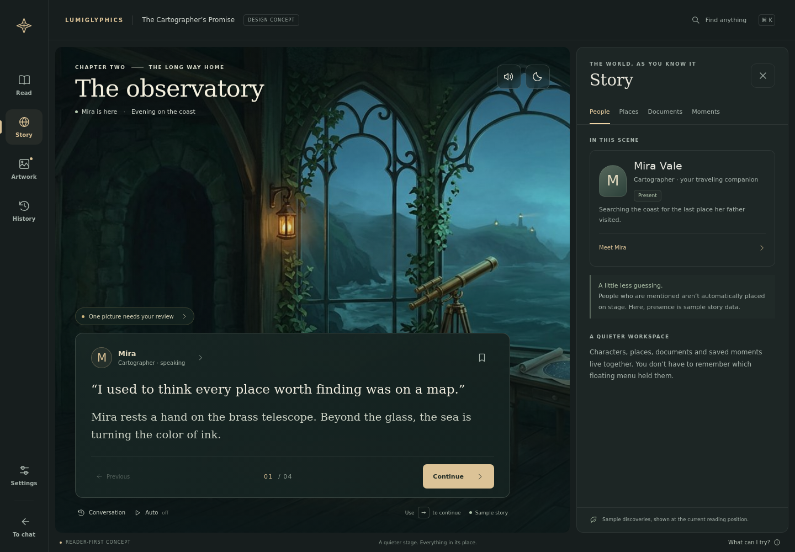
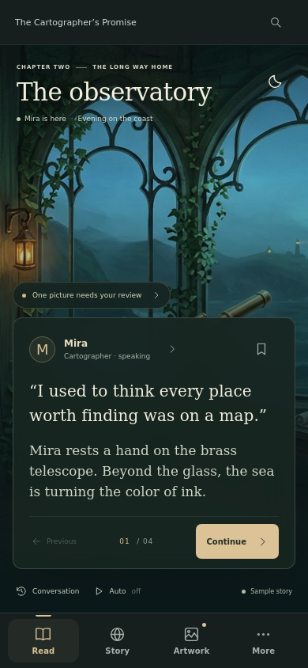

# Lumiglyphics: a reader-first overhaul

**24 October 2026 · Design proposal, not an approved migration or shipped extension update**

## The idea: a quiet reader, a predictable workspace

Lumiglyphics should feel like **a polished visual novel with an optional backstage**, not a chat extension with a growing collection of floating tools.

The overhaul is structural first, cosmetic second:

> **Read in the center. Explore and adjust in one consistent workspace. Return without losing your place.**

This proposal is based on the beta.72 reader, stage, settings routes, dossiers, reviewer and theme implementation. It does not claim a complete hands-on audit of the installed Lumiverse experience.

### Try the concept

An isolated interactive prototype lives at [`design-concepts/reader-first/index.html`](design-concepts/reader-first/index.html). A live preview is available under **Lumiglyphics redesign concept** while its preview process is running.

It demonstrates reader navigation, a shared workspace, character details, reveal-gated sample documents, saved moments, a sample artwork approval, settings previews, local reply drafts, menu search, focus reading and mobile navigation.

**All content is sample data.** No host API, real generation, payments, provider configuration or persistent storage is connected. Sound is a visual control example; no audio plays. New mechanics such as Moments are illustrative proposals, not claims about today's extension.



---

## 1. The new information architecture

Five destinations on desktop. Each answers a distinct question:

| Destination | User question | Contents |
|---|---|---|
| **Read** | What is happening now? | Stage, dialogue, advance, reply, immediate reading controls |
| **Story** | Who or what is this? | People, Places, Documents; proposed Moments |
| **Artwork** | What is being shown, prepared or repaired? | Current-scene pictures, review, replacements, compatible art, library |
| **History** | Where was that passage or version? | Conversation, source versions, pictures tied to passages, saved return points |
| **Settings** | How should the experience work? | Reading comfort, appearance/sound, provider/setup, specialist controls |

**On phones:** Read, Story, Artwork and More form a labeled bottom bar. History and Settings live in More. No unlabeled hamburger as the only way to find everything; no eight-item bottom dock.

**The rule:** reader subjects live in Story; image operations live in Artwork; navigation through earlier material lives in History; configuration lives in Settings. Shortcuts can deep-link between them, but they never create a second independent implementation.

### Where existing features go

| Existing surface or responsibility | Proposed home | What stays distinct |
|---|---|---|
| Main VN stage and paragraph navigation | Read | Existing modes and full-scene compositions remain supported |
| Cast portraits and active-speaker state | Read | Speaking, physically present and drawable are not conflated |
| Character dossier and scene-reference menu | Story → People / Places | Reader facts versus editable presentation guidance |
| Document viewer and object references | Story → Documents | Literal text, access state and reveal position |
| Image reviewer, prepared brief and replacement editor | Artwork → This scene → selected picture | Prepare, approve, regenerate and replace retain separate meanings |
| Supplied/display art and image browsing | Artwork → Library | Provenance and compatibility remain visible |
| Backlog | History → Conversation | Current conversation versus older/alternate source versions |
| Saved image history | History, linked to source; Artwork for asset selection | An asset's uses are not erased by deduplication |
| Theme, text speed, audio and reader preferences | Settings → everyday preferences | No automatic model/spending change |
| Connections, prompt tools, raw parameters, filtering and CSS | Settings → Setup / Advanced | Technical depth remains available; it is not deleted |
| Pinned companion panels | Optional stage dock or workspace integration | Preserve sandboxing, independent providers and reset-to-visible recovery |
| Return to host chat | Stable Back to chat action | Not the same action as closing a workspace |

Story and Artwork settings are not mixed into reader facts: viewing Mira's dossier does not implicitly edit her appearance or generate a portrait. A clearly named “Edit visual guidance” action can deep-link to the appropriate editor.

---

## 2. The reader: make the story the loudest thing

### Keep visible

- A restrained scene title/location **only when established metadata exists**. Otherwise use the host title or a neutral current-scene label.
- One readable dialogue surface with a clear speaker, selectable text and a stable Continue action.
- Previous passage, Conversation and Auto within the reading area.
- A bookmark/return-point action if that proposed feature is approved.
- A compact, actionable image-status chip only when something needs attention.
- A focus-reading action with an obvious way back.

### Move out of the reading surface

Prompt budgets, model selection, template editing, raw diagnostics, cast source reconciliation and replacement parameter editing. They are important—but they do not belong beside every line of dialogue.

### Your turn is an intentional state

When a reply is needed, keep the source passage visible and open a focused composer. Suggested actions fill an editable draft. They do not execute, declare success or silently submit.

The prototype's composer is deliberately local-only. Production Send must be explicit, preserve the host's submission policy and prevent duplicate actions. Keep unsent text across navigation, source-safe transitions and recoverable failures.

### Cast view remains a first-class mode

The observatory prototype illustrates an environment scene, not the removal of Cast view. In production, reserve a stage region for compatible portraits; clicking a portrait opens the same Story detail surface. Active-speaker styling should be quiet, but always identifiable without animation. A remote speaker does not automatically occupy a stage slot.

**No new paid work** occurs just because navigation, focus mode or a portrait detail is opened.

---

## 3. One workspace, not a stack of unrelated modals

### Desktop

A docked side workspace leaves the reader visible. Its anatomy is always:

1. A title explaining the current destination.
2. A single close action returning to the reader.
3. A short set of destination-specific tabs.
4. A scrollable body.
5. Optional scope/status explanation.

A character, document or image detail replaces the workspace body. It has a **Back to People / Documents / This scene** action. It does not open another floating window on top of the first one.

### Mobile

The same workspace becomes a full-height content sheet between the title bar and bottom navigation. This is a navigation surface, not a small desktop modal crammed onto a phone. The underlying reader becomes inert while covered; navigation remains usable.

On short screens, keep primary reading controls visible and allow the passage itself to scroll when necessary. Large-text/zoom acceptance still needs dedicated testing; a compact viewport is not permission to shrink text indefinitely.

### Universal navigation contract

- **Back:** go one detail layer up, restoring that layer's scroll and focus.
- **Close:** return to the reader without resetting the cursor.
- **Back to chat:** leave the reader through the host-supported operation.
- **Escape:** one layer at a time; never also advance the passage.
- **Switch destination:** keep valid unsent drafts; do not silently save or discard edits.
- **Browser/Android Back:** integrate only with a verified host navigation contract, not an extension-wide history hijack.

Destructive confirmations may still use true modal dialogs. Those dialogs need proper focus management. “One workspace” does not mean removing necessary confirmations.



---

## 4. Visual direction: a visual novel, not a control dashboard

### Suggested default: mineral dark, warm paper, restrained brass

- **Background:** deep charcoal/green-black, rather than pure black everywhere.
- **Panels:** matte, quiet surfaces with one subtle border; blur is an enhancement, not required for text contrast.
- **Text:** warm off-white; soft secondary text that still passes contrast checks.
- **Accent:** muted brass for primary actions and selection; sage for neutral availability/status.
- **Typography:** literary serif for story text, clean system sans for navigation and controls. Offer an accessible all-sans option in production.
- **Shape:** a small consistent radius scale, not different pill/card styles for every tool.
- **Spacing:** a shared 4/8/12/16/24/32 scale.
- **Icons:** one line-icon family, supplemented by labels; not a puzzle of unfamiliar symbols.
- **Motion:** short opacity/focus transitions, cancellable and subordinate to reduced-motion settings. No necessary information conveyed by movement alone.

**The concept's palette is a starting direction, not a mandated permanent skin.** Existing Lumiverse/theme integration should remain. Themes can change color and texture without moving controls, renaming actions or changing the navigation contract. Anime, sci-fi, contemporary and cozy stories should all fit the same shell.

### Hierarchy rules

1. The passage is visually primary.
2. Continue/Send is the one primary action in its context.
3. Speaker and scene context are secondary.
4. Tools are quieter than content.
5. Technical metadata appears when requested.

Primary labels and active controls must not depend on the small decorative typography in this concept. Production acceptance includes contrast, 200% text scaling, touch targets, localization and long labels. Final accessible font metrics need validation across actual host themes.

---

## 5. Artwork: understandable intent first, technical detail second

Instead of initially confronting the reader with a long prompt and several similar-looking recovery buttons:

> **The observatory**<br>
> Environment · evening · coastal interior<br>
> Ready for review<br>
> **Approve** · Inspect details

Inside details:

- People / identity sources
- Action and composition
- Environment and lighting
- Template/style attribution
- Output/capability explanation
- Raw prompt and parameters, expandable

Keep four operations visibly distinct:

- **Rewrite prompt:** change preparation wording.
- **Retry generation:** repeat an eligible failed attempt under the existing policy.
- **Generate replacement:** request a new image, with spending/approval consequences.
- **Use existing art:** change assignment without requesting a new image.

Show the selected picture's actual saved metadata. An edited draft must not retroactively describe the image already on screen. Unsupported operations remain unavailable with a reason, not silently ignored.

A failed image should not destroy the reading layout. Keep the last valid scene, a scoped notice and the correct recovery path.

---

## 6. Settings: everyday comfort versus specialist setup

The current routes (`src/frontend/settings/routes.ts`) span 22 pages. The problem is not simply the number of fields; it is requiring the user to understand the implementation before knowing where to look.

Proposed front door:

### Everyday preferences

- **Reading:** text size, speed, autoplay and controls.
- **Look & sound:** theme, dialogue layout, motion, speech, music and SFX.
- **Artwork preferences:** review policy, compatible reuse and generation limits, with explicit scope/cost explanation.

### Setup and specialist tools

- Connections and verified capabilities.
- Generation/model configuration and advanced prompt tools.
- Context sources and source policy.
- Filtering, custom CSS, diagnostics, storage and reset.

This is a navigation regrouping, **not the removal or silent reset of existing configuration**. Deep pages can survive under a calmer hierarchy. A reader-level quick preference should link to its full editor.

Every consequential setting explains:

- **Scope:** all chats / this chat / this picture.
- **Timing:** immediate / next preparation / new images only.
- **Cost:** no new work / may request generation / pricing unavailable.

Menu/action search should deep-link to exact destinations. Start with local navigation and configuration labels, not unrestricted search over private or unrevealed story text.

---

## 7. Polish that makes the overhaul feel complete

- Same close button, headers, spacing and focus treatment everywhere.
- Stable toolbar/image geometry when loading, errors and long speaker names appear.
- Never let a completed background operation steal focus or jump the scroll.
- Correct composite draft keys for replacements and deliberate draft ownership across revisions.
- Clear unavailable/legacy/source-deleted states instead of inferred replacements.
- Image decode failure keeps valid art and explains the display problem.
- Audio gain ramps that respect user volume, mute and cancellation.
- Auto pauses for overlays and user reply; opening a panel never burns through unseen paragraphs.
- A quiet “needs review” signal, not an always-visible diagnostics dashboard.
- First use begins with a useful reader. Configure a missing provider only when the user requests the relevant capability; do not trigger paid work through an onboarding preview.
- Plain-reading/focus modes are reversible and retain the same story position and drafts.
- Shared components must retain sandbox and source/reveal boundaries; consolidation is not permission to inject trusted HTML from arbitrary providers.

---

## 8. How to ship a complete overhaul without a dangerous rewrite

Keep the existing TypeScript/Shadow DOM stack and backend ownership. A framework migration adds risk without solving navigation.

### Phase 1 — navigation and overlay foundation

Build a small shared workspace controller, route model, surface header, tabs, focus/scroll restoration and draft handoff contract. Add the new shell behind an opt-in UI flag. Use current dossiers, reviewer and settings as content adapters first; do not rewrite their business logic simultaneously.

**Gate:** one workspace visible; predictable Back/Close; no cursor resets; no paid calls from browsing; mobile/keyboard flows verified.

### Phase 2 — reader and visual system

Apply shared tokens/components; reserve geometry; simplify reader controls; preserve Cast/full-scene modes; implement reversible focus reading. Keep existing theme compatibility and accessible fallback styles.

**Gate:** long text, narrow phones, large text, reduced motion, image errors and rapid source changes do not break reading.

### Phase 3 — Artwork and settings journeys

Consolidate image operations under a shared scene/picture hierarchy. Give settings an everyday-versus-setup front door and exact search destinations. Retain every existing field's mapping and saved value.

**Gate:** unchanged backend approvals, provenance, spending policy, replacement-draft recovery and source-version ownership.

### Phase 4 — Story and History cohesion

Bring dossiers/documents into the same surface. Connect History items to exact eligible sources and artwork. Add manual Moments only if approved; source-backed cross-turn features depend on reconciliation and compact projections from the audit.

**Gate:** zero future-paragraph/alternate-branch disclosures, honest missing-source states, bounded indexing and no guessed ancestry.

### Phase 5 — host and device acceptance

Compare existing and new flows in real supported Lumiverse versions. Check physical Android/iOS keyboard, Back, rotation, zoom, safe areas, speech/audio and representative provider combinations. Do not call fixture success real-device certification.

**The current audit's severe lifecycle, stale-write, prompt-protection and projection-size issues remain prerequisite engineering work**, not problems a new shell will solve by itself.

---

## 9. Prototype verification and limits

**Verified in a headless Chromium environment:** 28 checks covering desktop navigation, tabs/keyboard, one-layer Escape, opener-focus restoration, reveal-gated sample documents, exact saved-passage return, note escaping, local draft preservation, artwork status, setting previews, focus mode, search and 390px/320px phone layouts. Four screenshots were generated from the actual prototype.

Run with a static server for the prototype directory, then:

```sh
node docs/design-concepts/reader-first/verify.mjs
```

The check runner expects `http://127.0.0.1:4174` by default. Override `CONCEPT_URL` for another test origin. A normal Playwright browser installation is required; `CONCEPT_CHROMIUM_PATH` optionally supplies another executable.

**Not verified:** physical devices, the installed host integration, all supported locales/themes, real large-text assistive-technology behavior, paid image providers, storage migrations or sound. None of the extension's production UI files were changed for this concept. The test runner's screenshots are design artifacts, not pixel baselines for the existing app.

## The decision to make

Approve or adjust the **structure** before debating every color:

1. A reader plus one shared workspace.
2. Five clear desktop destinations, four mobile entries.
3. Story knowledge separated from artwork operations and technical configuration.
4. A consistent Back/Close/return contract.
5. Calm defaults with specialist depth available on demand.

If those five choices feel right, the rest can be refined without redesigning the navigation again. That is the real overhaul: **not prettier menus individually, but a system in which every feature has an obvious place.**
