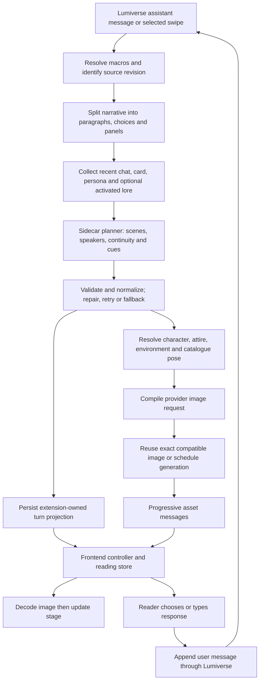

> Historical read-only audit: the Bun/toolchain and test limitations below describe the initial review, before source import and implementation. Current verification is in `docs/IMPLEMENTATION_STATUS.md` and `docs/review-evidence/implementation-validation.json`.

# Lumiglyphics: Cue — Living Novel source review

Reviewed October 10, 2026, America/New_York. This is an investigation and development reference, not a claim that Lumiglyphics has been implemented or installed.

## Sources and current project state

- Original: [japolino/cue-living-novel](https://github.com/japolino/cue-living-novel).
- Pinned revision: [`842d397d34bbb2952153f33739c8b13e70d5177b`](https://github.com/japolino/cue-living-novel/commit/842d397d34bbb2952153f33739c8b13e70d5177b), `chore: release visual pass as v1.7.0-beta`, authored October 4, 2026 UTC.
- Product version in both package and manifest: `1.7.0-beta`.
- Target: [drinkwaterdrink/Lumiglyphics](https://github.com/drinkwaterdrink/Lumiglyphics), described as “visual storytelling.” GitHub returned no branches; it currently has no source commits.
- Local workspace: `C:/Users/trent/OneDrive/Documents/ChatGPT/Lumiglyphics`. Its Git root is this directory. Initially it contained only `.git`, an unborn `master` branch, no commits, and no configured remotes. No Git configuration, commits, branches, or remotes were changed by this review.
- Source was downloaded into a separate temporary review directory. Product source in that copy was not edited. Inspection helpers and test logs were created there; this workspace contains the resulting review and evidence only.
- Source inventory: 182 TypeScript files under `src`, comprising 91 implementation files and 91 test files. Implementation files contain approximately 34,000 lines. This excludes scripts and documentation.

The manifest's minimum Lumiverse version is `1.1.6`, and its type package is `lumiverse-spindle-types@0.6.23`. Upstream describes compatibility with a particular staging host; that statement does not establish compatibility with the user's running Lumiverse installation.

## What the extension does

Cue presents a Lumiverse chat as a fullscreen visual novel. The original conversation remains authoritative. Cue builds its own stored presentation from assistant messages and temporarily replaces the visible chat/input components while its view is open.

Existing capabilities include:

- Paragraph reveal, typewriter text, Previous/Continue, Auto and Skip, and a final acknowledgement gate before responding.
- Standard typed responses or CYOA choices. Selected choices and typed replies become ordinary Lumiverse user messages and trigger ordinary chat generation.
- Generated scene illustrations, existing card-art mode, character reference anchoring, per-provider image concurrency, deduplication, progressive image updates, and decode-before-swap.
- Character appearance/wardrobe continuity, stable character identifiers and explicit aliases, environment state, and reconciliation after swipes, edits, deletes, and chat changes.
- Background music, sound effects, ambient particles, one-shot stage effects, inline text effects, seven theme presets, image-fit choices, text sizing, and custom CSS.
- Optional paragraph TTS with narrator/character voice selection, playback controls, and default-off autoplay.
- Pinned HTML/SVG status panels and bridges for companion extensions such as SimTracker and Warp.
- Optional System One/Jev classification to assist presentation decisions and reuse familiar scenes.

This is a renderer and presentation planner around Lumiverse. It does not replace the main roleplay model, maintain an independent canonical story, or run a separate rules engine.

## The actual runtime flow

1. **Activation:** `src/frontend/host/controller.ts` mounts an `app-overlay`, registers a settings tab and launch controls, and checks for the staging component-override API. While active it replaces `BubbleMessage`, `MinimalMessage`, and `InputArea` with null components. Closing the overlay destroys the overrides. A separate safety surface keeps Back to chat outside custom stage CSS.
2. **View gating:** frontend `vn_view`/`vn_get_state` announcements tell the backend which chat is open. Ordinary automatic planning and image work run only for an enabled extension with an open view. Closing cancels extension work; incomplete images need a manual retry. The explicit external-image integration has its own request lifecycle.
3. **Message intake:** `message-text.ts` resolves host macros without committing variable mutations and handles multi-scene greetings. It tracks both raw and selection fingerprints so random/time macro changes do not automatically masquerade as deliberate scene selection. If a greeting has no selected narrative, the UI waits instead of illustrating every alternative scene.
4. **Planning:** `planner.ts` calls `spindle.generate.raw` using a selected text connection. This is an additional model call for presentation, distinct from the normal chat reply. It supplies recent messages, selected visual context, previous continuity, character information, and indexed paragraphs. Output is normalized/repaired and validated through Zod. There are two planner attempts before a deterministic fallback. Optional System One can classify speaker/expression/audio and bypass the prose planner for eligible short, familiar continuations.
5. **Visual resolution:** registry and timeline logic select the visible character, durable appearance, changing attire, and environment for each cue. Expressions resolve through a finite catalogue. Actions/props use bounded contracts. Free-form `promptDelta` is discarded.
6. **Image generation:** `images.ts` compiles the resolved cue through the vendored Inlay prompt compiler. The active path uses one subject with a fixed upper-body, eye-level, straight-on camera. NovelAI has model-aware prompt formatting. The scheduler prioritizes assets and bounds concurrency. An exact compatibility cache can reuse a generated image without another provider call.
7. **Storage and delivery:** the backend stores turn records and continuity, then sends targeted `vn_turn` and `vn_asset` messages. The frontend retains a prior valid picture while new art loads, decodes the new image before display, and acknowledges browser readiness.
8. **Responses:** `vn_submit` calls `spindle.chat.appendMessage(..., { triggerGeneration: true })`. Submission IDs help avoid replaying a saved response, and the error path checks whether a failed call nevertheless saved it. Illustration processing does not rewrite existing chat prose.

## Where future features belong

All paths below refer to the original repository at the pinned revision. The table is a code map, not a list of approved new features.

| Area | Main paths | Suitable changes |
| --- | --- | --- |
| Entry points and host integration | `src/backend.ts`, `src/frontend.ts`, `src/frontend/host/controller.ts`, `staging-context.ts` | Activation, host API adapters, launch controls, cleanup |
| Shared configuration | `src/config.ts`, `src/speech-config.ts` | Settings, defaults, bounds, migration compatibility |
| Settings UI | `src/frontend/settings/model.ts`, `panel.ts` | User controls, advanced drafts, search, save feedback |
| Protocol and contracts | `src/protocol.ts`, `src/shared/contracts.ts` | New requests/results and validated state fields |
| Canonical message intake | `src/backend/runtime/message-text.ts`, `src/backend/core/paragraphs.ts` | Macro-aware narrative extraction, choices and inline panels |
| Planner and context | `src/backend/runtime/planner.ts`, `context.ts`, `system-one.ts` | Scene interpretation, context budgets, attribution, planning diagnostics |
| Character and continuity state | `src/shared/identity.ts`, `character.ts`, `action-prop.ts`, `src/backend/core/continuity.ts`, `visual-state.ts` | Cast identity, appearance, wardrobe and bounded action state |
| Image requests and references | `src/backend/runtime/images.ts`, `reference-source.ts`, `native-assets.ts`, `src/backend/inlay-prompt/` | Prompt compilation, provider adapters, references, card assets |
| Jobs and reuse | `src/backend/core/planning-queue.ts`, `asset-scheduler.ts`, `scene-image-cache.ts` | Scheduling, deduplication, stale ownership and cache policy |
| Persistence | `src/backend/runtime/storage.ts` | Settings and schema migrations, per-chat projections, portraits |
| Reading behavior | `src/frontend/store/vn-store.ts`, `src/frontend/stage/vn-stage.ts` | Reveal/navigation/input flow and stage rendering |
| Visual presentation | `src/frontend/theme/`, `src/frontend/stage/procedural-particles.ts`, `text-effects.ts` | Themes, effects, accessibility, layout |
| Sound and speech | `src/backend/runtime/audio-catalog.ts`, `src/frontend/stage/audio-engine.ts`, `src/frontend/speech/` | Music/SFX selection, voice mapping and speech transport |
| Companion integrations | `src/frontend/host/game-bridge.ts`, `image-bridge.ts`, `src/frontend/stage/panel-dock.ts`, `src/backend/runtime/external-images.ts` | Engine choices, live panels and illustration requests |

Keep framework-free state logic, host adapters, and model/provider adapters separate. A new visual setting typically needs config normalization, settings UI, frontend application, and an existing behavioral test. A new planner field additionally needs a schema, normalization, prompt instructions, continuity resolution, persisted compatibility, and protocol mapping.

## Persistence and ownership boundaries

- Settings, per-chat state, character registries, appearance records, per-turn records and portraits use `spindle.userStorage`, generally with the originating `userId`.
- Typical paths are `config.json`, `chats/<chat>/state.json`, `chats/<chat>/visual-state.json`, and `turns/<chat>/<message>/<swipe>.json`; storage serializes writes to avoid concurrent overwrites.
- Generated images are persisted by Lumiverse's image-generation API. Extension records keep IDs, URLs and provenance; portrait records can also hold reference image data.
- The scene image cache is temporary backend memory, scoped by user/chat and scene episode, bounded to 256 entries and 1 MiB of metadata. It holds references, not image bytes. Restarting clears it; switching chats releases the previous scope.
- Imported music/SFX use `spindle.storage` and a module-level audio catalogue. In an operator-scoped installation this is shared extension storage. Decide whether a shared library is intended before adding personal audio libraries.
- Pinned panels, layout and extraction rules are browser-local `localStorage` under `vn-panels-v1:<chat>`. They do not currently synchronize through backend user storage. Speech audio is a session cache, not a permanent media library.
- Normal request replies target a `userId`. Permission notifications deliberately omit it. Current documentation distinguishes targeted sends from operator broadcasts; new private results should always use the targeted form.

## Important constraints and follow-up findings

### Build reproduction is currently blocked by the local toolchain

Upstream specifies `bun@1.4.0` / Bun `>=1.4.0`, TypeScript `7.0.2`, Playwright `1.63.0`, and `lumiverse-spindle-types@0.6.23`. Installed Bun is `1.3.14`. A frozen, script-disabled dependency installation failed on `bun.lock` version 2 with `UnknownLockfileVersion`. No lockfile regeneration or dependency substitution was performed. Availability and compatibility of the exact required toolchain still need verification before building the derivative.

### Source and older documents disagree about the active image behavior

The current code can change the visible character between cues using durable registry IDs and a timeline, and persists wardrobe separately from permanent identity. Each image still has exactly one subject. The active compiler camera is `upper body`, `eye level`, `straight-on`; the README's wider-camera wording is not an accurate compiler contract. A 16:9 field in scene metadata is not proof that each image workflow enforces those dimensions.

`IMAGE_GENERATION_AUDIT.md` describes an older September 4 revision. Current code includes subsequent remediation such as per-cue resolved identity, bounded action/prop support and provider-aware NovelAI handling. Do not treat every historical finding in that file as an unresolved current defect.

Multi-person illustrations, freely changing camera angles, or permanent appearance transformations would alter existing contracts and prompt/cache semantics. They are architectural changes, not simple prompt edits.

### Host compatibility needs a live check

`registerComponentOverride` is feature-detected and documented by upstream as staging-specific. The current public UI-placement page reviewed does not document that method. Version numbers alone cannot certify the running host provides it. Current Lumiverse docs also describe backend `process` mode as the default; references to a “worker” in upstream or cached skill guidance can be historical terminology.

Speech uses same-origin authenticated internal routes such as `/api/v1/tts/synthesize` and `/api/v1/tts-connections`, rather than a versioned Spindle TTS consumer API. It is default-off, uses host connection profiles, and has bounded requests/cache. Its route compatibility and audio behavior need live validation.

Pinned panels sanitize HTML/SVG and use an empty iframe sandbox plus CSP. Current developer docs recommend host-managed sandbox frames. Preserve the existing isolation protections and evaluate the supported host frame API when changing panel rendering.

### Cancellation drops stale results but does not prove provider work stopped

The planning queue and image batch have abort controllers and ownership checks. `PlanTurnInput` does not currently carry a signal into `spindle.generate.raw`, and the image request shown in `images.ts` does not forward its local signal to the provider API. Closing prevents subsequent work and rejects stale completions; already dispatched work may continue. Current generation docs expose signal support for raw requests, which is a potential improvement to evaluate against the target host.

### The external image bridge interprets a zero budget differently

Settings and normal planning interpret `maxImagesPerTurn: 0` as unlimited. `external-images.ts` instead rejects zero as an empty budget. This is a source-confirmed inconsistency affecting external illustration requests, with no live reproduction performed in this review. Unify the meaning if the derivative retains this bridge.

### Manifest metadata and reuse terms need attention

The source manifest lacks `github` and `homepage`, which the current manifest documentation marks required. No install was attempted, so this is a documentation mismatch rather than a demonstrated installer failure.

The original identifier is `visual_novel_preview`, retained for upstream upgrades. A separately installed Lumiglyphics version should have a distinct identifier and explicit migration/import behavior if old Cue data is to be brought across. Reusing the identifier could mix installation identity and extension storage.

No license file was found, and GitHub reports `license: null`. Confirm the author's reuse terms before publishing a derivative; public visibility does not itself establish a general reuse license. The compiler includes attribution to `japolino/inlay-illustrator@2247423`, and the repository includes an audio archive, so retain and check those sources as well. See [GitHub's licensing guidance](https://github.com/github/docs/blob/main/content/repositories/managing-your-repositorys-settings-and-features/customizing-your-repository/licensing-a-repository.md).

## Validation performed

| Check | Result | What it establishes |
| --- | --- | --- |
| Git root / local status | Correct project root; initially empty and unconnected | No inherited `C:/.git` or existing local code |
| GitHub metadata and source snapshot | Pinned main revision; all 220 downloaded files match their Git blob hashes; target has no branches | Provenance, snapshot integrity and current repository state |
| Generic Lumiverse artifact audit | Four advisory findings: two absent `dist` files and two permissions requiring justification | Structural observations only |
| Dependency installation | Failed: Bun 1.3.14 cannot parse lockfile version 2 | Required toolchain mismatch; no reproducible full build yet |
| Dependency-free upstream subset | **421 passed, 0 failed, 2,287 assertions across 35 files** | Exercised pure/helper behavior and mocked frontend/backend adapters |
| Earlier broader subset attempt | Interrupted while stalled in speech transport timeout tests on Bun 1.3.14 | No pass claim for that complete attempt; recheck using supported Bun |
| Full tests, typecheck and build | Not completed | Core schema/planner/runtime suite and bundles remain unverified |
| Browser regression scripts | Not run | Real Chromium layout and interaction remain unverified |
| Lumiverse install, live planner/image/TTS calls | Not performed | No runtime/provider-quality claim |

The completed test log includes a Bun ancestor-directory `EPERM` diagnostic; Bun nevertheless exited 0 and reported 421 passes / 0 failures. Keep that environment warning separate from the test result.

The generic audit's missing `dist` findings are expected for a source checkout because `dist` is ignored. Current Lumiverse quick-start docs describe auto-building from `src`; they are not sufficient evidence of an installation failure. `chat_mutation` is used for submissions and `app_manipulation` for the overlay, so these permissions have concrete uses.

Evidence is saved under `docs/review-evidence/`. No live user content, credentials or secrets were involved.

## Recommended development sequence

This is a recommendation for the next stage, not an approved implementation specification.

1. Define the first desired feature and target Lumiverse version/build; decide whether Lumiglyphics should coexist with Cue and whether existing settings/state should be importable.
2. Establish reuse terms and retain upstream/vendored attribution.
3. Bring the pinned upstream baseline into the target repository, preserving provenance. Give Lumiglyphics its own manifest identity and repository metadata.
4. Verify the exact toolchain, run the full upstream verification, build the bundles, and scan the actual backend bundle. Preserve a known baseline before behavior changes.
5. Design and implement the first feature in the mapped modules, retaining canonical chat ownership, per-user state, stale-result guards, image reuse correctness and the exit path.
6. Run the relevant existing regression tests, then test install/activation/exit, chat transitions and provider behavior in the actual Lumiverse host.

## Official docs consulted

- [Spindle overview and current runtime note](https://docs.lumiverse.chat/)
- [Quick start and source auto-build](https://docs.lumiverse.chat/getting-started/quick-start/)
- [Manifest fields](https://docs.lumiverse.chat/getting-started/manifest/)
- [Backend capabilities and scanner](https://docs.lumiverse.chat/getting-started/capabilities/)
- [Storage and per-user scope](https://docs.lumiverse.chat/backend-api/storage/)
- [Backend/frontend targeting](https://docs.lumiverse.chat/backend-api/frontend-communication/)
- [User context](https://docs.lumiverse.chat/backend-api/user-presence/)
- [Generation and cancellation](https://docs.lumiverse.chat/backend-api/generation/)
- [Events](https://docs.lumiverse.chat/backend-api/events/)
- [Chat mutation and normal generation](https://docs.lumiverse.chat/backend-api/chat-mutation/)
- [Frontend UI placement](https://docs.lumiverse.chat/frontend-api/ui-placement/)

Use the pinned source and actual host APIs as implementation evidence. Documentation, automated checks, and live runtime verification answer different questions.
